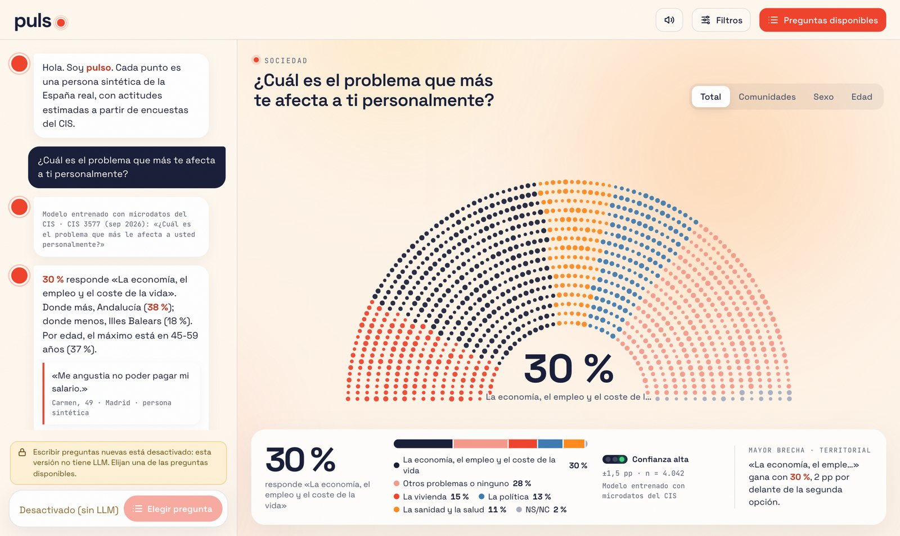
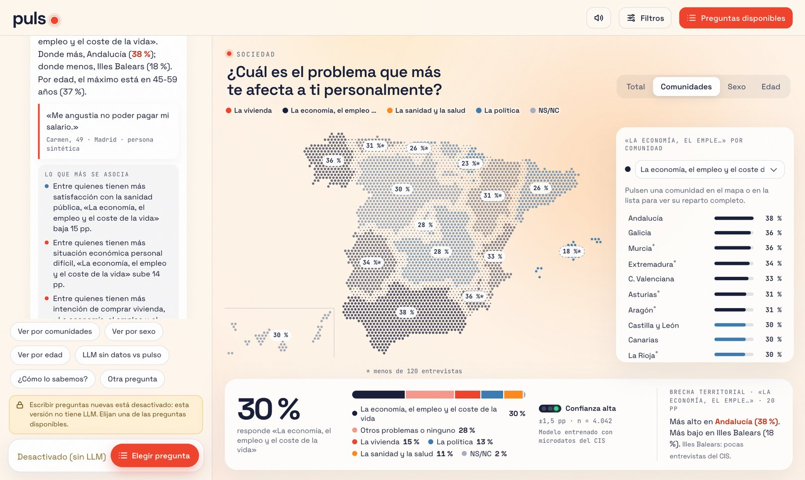
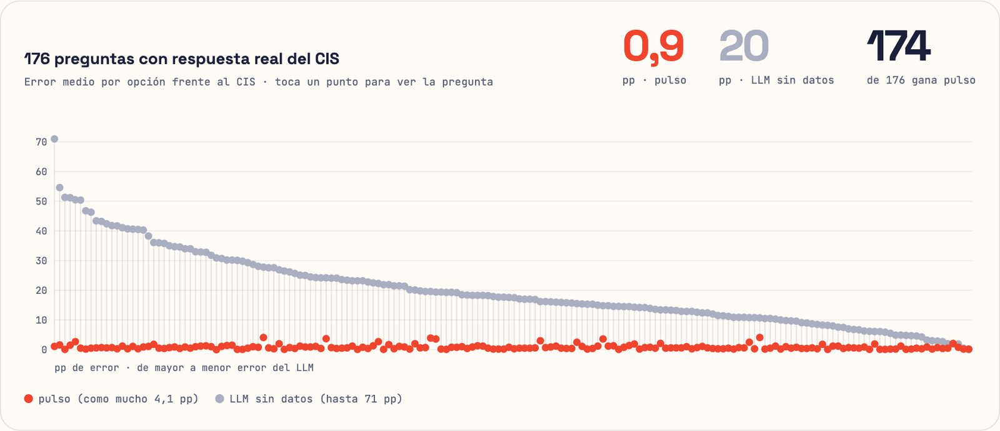
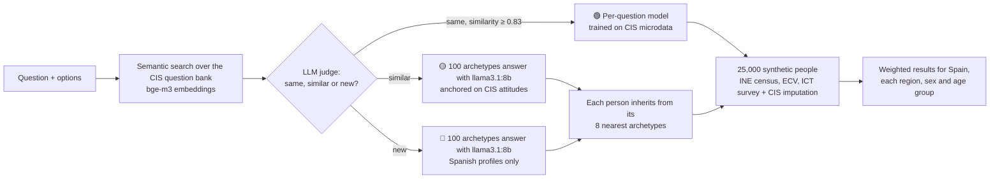
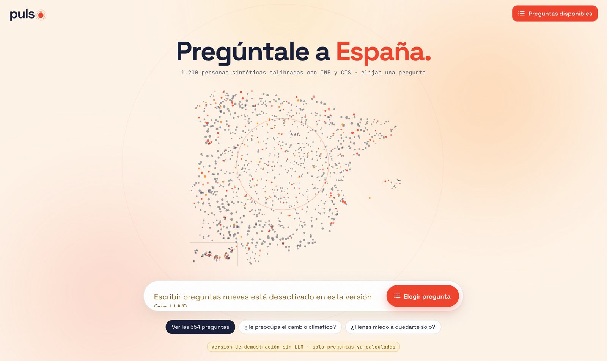
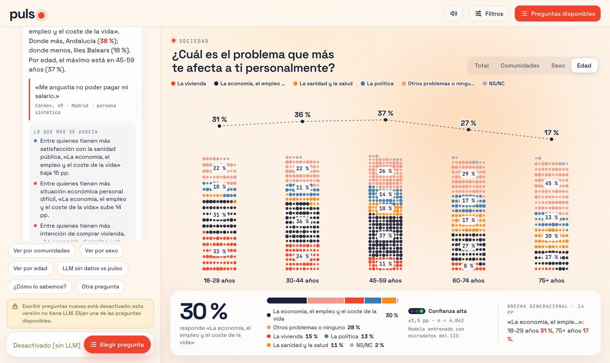
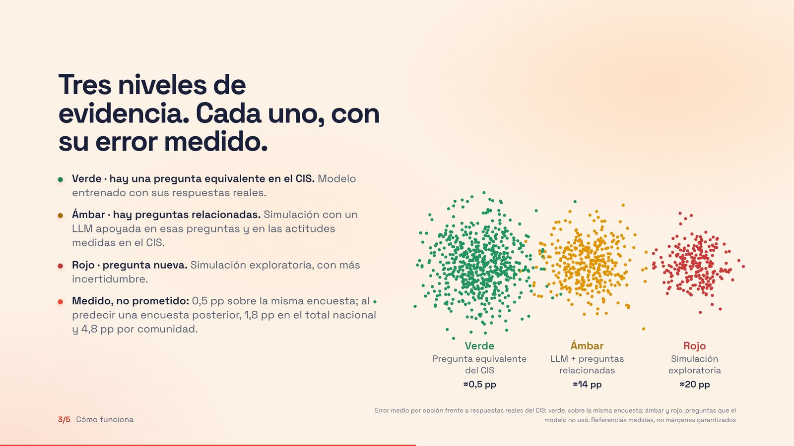

# pulso · Ask Spain

**A synthetic population of Spain that predicts how Spanish society would answer a survey question, a campaign or an A/B test, broken down by region, sex and age, with a confidence traffic light that tells you how far to trust each answer.**

🏆 **Winner of the Accenture GenAI Mavericks Challenge 2026, Challenge 3: "Synthetic Population of Spanish Society".**

| | |
|---|---|
| ▶️ **Live demo** (554 precomputed questions) | https://jjaramillo2023.github.io/pulso/?preguntas |
| 🌐 **Project site** | https://jjaramillo2023.github.io/pulso/proyecto/ |
| 🎤 **Final pitch deck** (with demo videos) | https://jjaramillo2023.github.io/pulso/presentacion/ |

The interface is in Spanish, since the product is built for the Spanish market.

<p align="center">
  
  
</p>

---

## The problem

A national survey in Spain takes weeks and can cost hundreds of thousands of euros. Asking a general-purpose LLM is instant, but its answers reflect stereotypes rather than people. We measured how bad that is. With no data behind it, an LLM says that 12 % of Spaniards over 60 are very worried about climate change. The CIS (Spain's public survey institute) measured 60 %.

## What pulso does

You type a question and its answer options. pulso answers in seconds with the predicted distribution for Spain and for every region, sex and age group. Each answer carries a label that says which evidence it rests on:

| Level | When it applies | How it answers | Measured error |
|---|---|---|---|
| 🟢 **Model trained on the CIS** | The CIS has already asked this question | A weighted multinomial logistic regression per question, trained on CIS microdata (9 studies, ~37,000 interviews), predicts the answer of each synthetic person | **≈0.5 pp** on the same survey; **1.8 pp** nationally and 4.8 pp by region when predicting the *next* edition of the survey (24 repeated questions) |
| 🟡 **LLM anchored on the CIS** | The CIS asked something similar | 100 archetypes answer with a local LLM (llama3.1:8b, reading token log-probabilities), each one conditioned on attitudes measured in the CIS | **±14 pp** (n = 14) |
| 🔴 **LLM with Spanish profiles** | A brand new question | The same simulation without CIS anchoring. Exploratory only | **±20 pp** (n = 6) |

All the errors are mean absolute errors in percentage points, measured against real CIS results by the validation scripts in this repo.

### The headline result

We compared pulso with an LLM that has no data on **176 questions** where the real CIS answer is known:

- **pulso:** mean error **0.9 pp** (worst case 4.1 pp)
- **LLM without data:** mean error **20 pp** (worst case 71 pp)
- **pulso is closer in 174 of the 176 questions**

<p align="center">
  
</p>

## How it works



1. **Synthetic population.** 25,000 profiles built from INE microdata (Census, Living Conditions Survey, ICT Survey), with ideology and religion imputed from the CIS. Each profile represents about 1,900 real people.
2. **Harmonization.** CIS respondents and synthetic people are mapped to the same 7 variables (sex, age, region, education, employment, ideology, religion), so a model trained on real interviews can be applied to every synthetic person.
3. **Routing.** The question is matched by meaning (not keywords) against ~300 CIS questions. An LLM judge decides whether the match is the same question, a similar one or a new one. Options are matched too, so "who will win the election" is never confused with "who would you vote for".
4. **Answering.** Green questions use the trained model. Amber and red questions are answered by 100 representative archetypes with a local LLM, and each synthetic person inherits from its 8 nearest archetypes.
5. **Delivery.** A FastAPI server streams progress to a canvas web app in which 1,200 animated dots regroup into the answer, a map, a hemicycle or bars by group. A static export of 554 precomputed questions runs on GitHub Pages with no backend.

<p align="center">
  
  
  
</p>

## Validation

Every number shown in the product and in the deck comes from these scripts:

| Script | What it measures |
|---|---|
| `04_calibrar_simulador.py` | Error of the LLM simulator against real CIS answers |
| `10_validar_ambar_rojo.py` | Routes 23 calibration questions as if their own survey did not exist and measures the amber and red error |
| `11_validar_tiempo.py` | Trains on one edition of a survey and predicts the next one (24 repeated questions). Repeating the old edition gives 1.5 / 1.8 / 2.9 / 4.9 pp (national / sex / age / region); pulso gives 1.8 / 2.1 / 3.1 / 4.8 pp |
| `motor.py` (`comparar`), run by `05_precalcular_demo.py` and `12_precalcular_catalogo.py` | The 176-question comparison against an LLM without data |

**Known limitations, stated openly.** Region shares in the synthetic population are not exactly those of the INE (Madrid 12 % vs 14.5 %), and reweighting changes national totals by only 0.17 pp on average. Amber and red answers are exploratory and are always labelled as such. 41 implausible LLM answers were removed from the public catalogue rather than tuned.

## Tech stack

- **Data and modelling:** Python, pandas, NumPy, scikit-learn, pyreadstat (SPSS microdata), PyArrow
- **LLM and retrieval:** Ollama running llama3.1:8b (simulation and judge) and bge-m3 (multilingual embeddings), all local, so no data leaves the machine
- **Backend:** FastAPI and Uvicorn, with streamed progress events
- **Frontend:** vanilla JavaScript and Canvas 2D (no framework), responsive down to mobile
- **Deployment:** static export to GitHub Pages; Playwright for screenshots and end-to-end checks

## Repository structure

```
├── index.html, app.js, …   Published web app (static build, served by GitHub Pages)
├── datos/                  Precomputed answers, validation results and the 25,000-person population
├── proyecto/               Project site
├── presentacion/           Final pitch deck with demo videos
├── docs/                   Screenshots for this README
└── source/
    ├── trabajo/            Engine: harmonization, CIS models, LLM simulator, routing, validation, API
    ├── frontend/           Web app source
    └── requirements.txt
```

## Running it locally

```bash
pip install -r source/requirements.txt
ollama pull llama3.1:8b && ollama pull bge-m3
cd source/trabajo && python -m uvicorn servidor:app --port 8765   # open http://127.0.0.1:8765
```

The raw inputs are not redistributed here. CIS microdata can be downloaded for free from [cis.es](https://www.cis.es) into `source/datos_cis/microdatos/`, and the synthetic population built by the team lives in the [team repository](https://github.com/anton-p0g/Accenture). The scripts are numbered in the order they run. The published demo needs none of this, because it is fully precomputed.

## My role

I designed and wrote the pulso engine and product end to end: the harmonization of CIS and INE data, the per-question CIS models, the LLM archetype simulator, semantic routing with the LLM judge, all the validation, the API, the web app, the static deployment and the final pitch deck, which I also presented.

**Team:** Juan José Jaramillo (engine, frontend and pitch), Adrián and Ainhoa (synthetic population database), Guillermo (backend), Anton Pogromskyy (visuals and frontend). The full team repository is [anton-p0g/Accenture](https://github.com/anton-p0g/Accenture).

## Ethics and data

All the profiles are synthetic, so no real individual can be identified. The sources are open (INE, CIS). Every answer is labelled with its level of evidence and its measured error, in line with the transparency obligations of Article 50 of the EU AI Act. The results are model predictions and do not replace a real survey.
